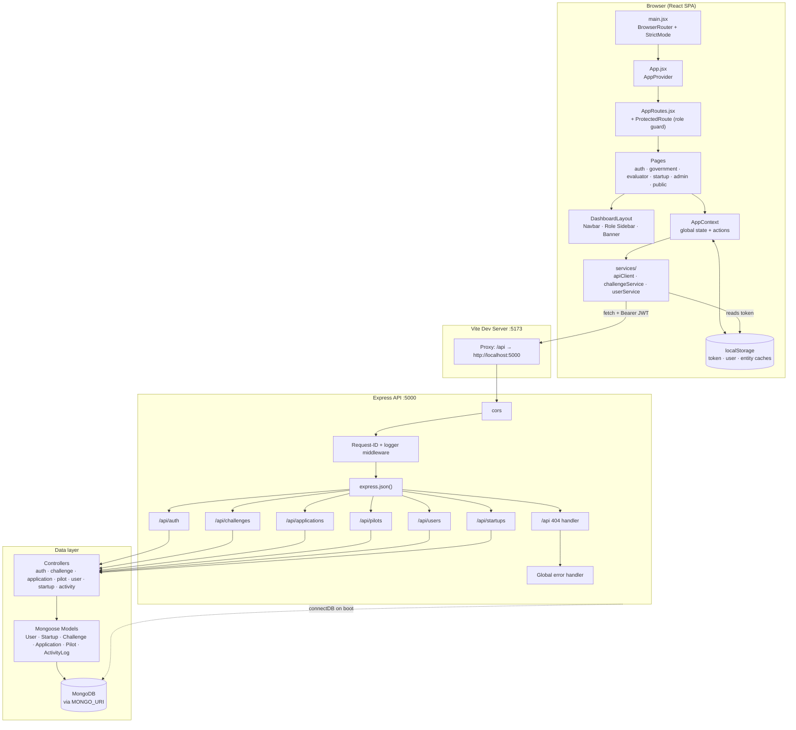
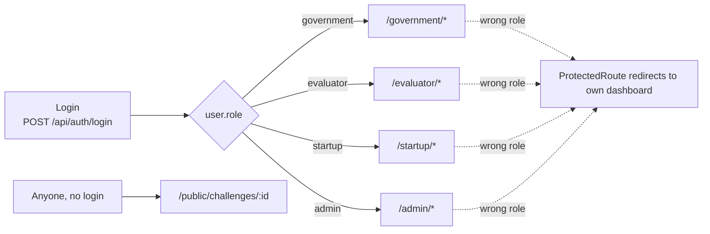
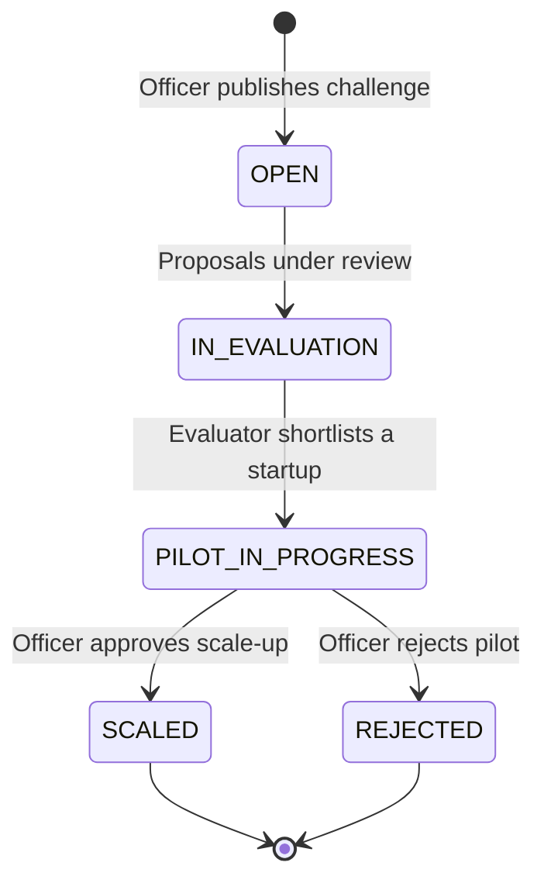
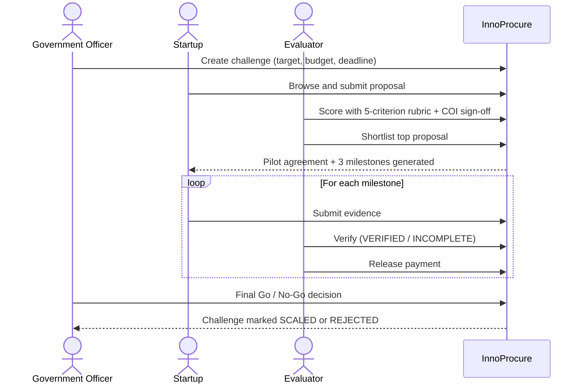
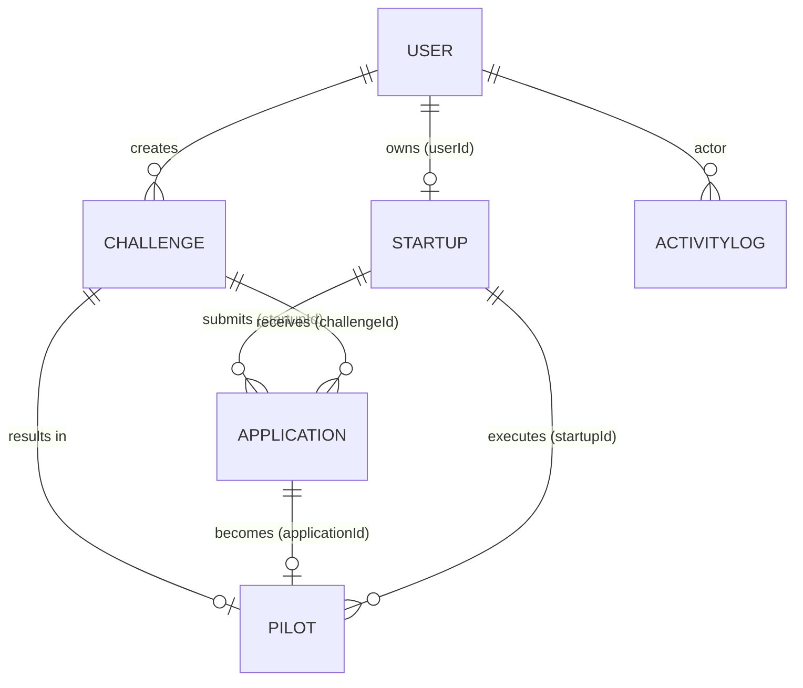
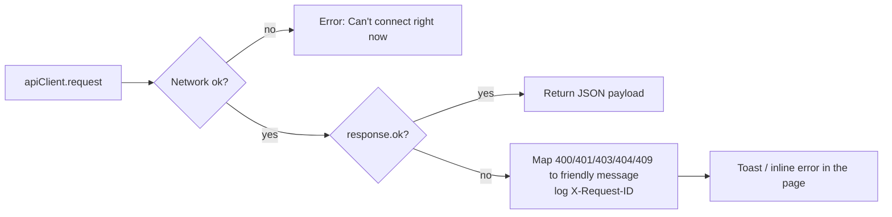

# InnoProcure

**Government-to-Startup Innovation Procurement and Piloting Platform**

InnoProcure connects government departments that have public-sector problems with DPIIT-recognised startups that can solve them. A department publishes a *challenge* with a measurable outcome target and budget; startups submit proposals; technical evaluators score and shortlist; a pilot runs under milestone-based payments; and the government officer makes a final **Go / No-Go scale-up decision**. A public transparency portal shows progress without exposing proprietary startup IP.

---

## Table of Contents

1. [Tech Stack](#1-tech-stack)
2. [System Architecture](#2-system-architecture)
3. [Ports and Network Map](#3-ports-and-network-map)
4. [Repository Structure](#4-repository-structure)
5. [Role-Based Access](#5-role-based-access)
6. [Procurement Lifecycle](#6-procurement-lifecycle)
7. [Frontend Architecture](#7-frontend-architecture)
8. [Backend Architecture](#8-backend-architecture)
9. [Database (MongoDB)](#9-database-mongodb)
10. [API Summary](#10-api-summary)
11. [Authentication Flow](#11-authentication-flow)
12. [Key Request Flows](#12-key-request-flows)
13. [Environment Variables](#13-environment-variables)
14. [Setup and Run](#14-setup-and-run)
15. [Implementation Status](#15-implementation-status)
16. [Troubleshooting](#16-troubleshooting)

---

## 1. Tech Stack

| Layer | Technology | Role in the project |
|---|---|---|
| UI library | React 19 | Component-based UI (`client/src`) |
| Routing | react-router-dom 7 | Client-side routes, role-guarded pages (`routes/AppRoutes.jsx`) |
| Build tool | Vite 8 | Dev server, bundling, `/api` proxy (`client/vite.config.js`) |
| Styling | Tailwind CSS 4 (`@tailwindcss/vite`) | Utility-class styling (`index.css`) |
| Linting | oxlint | `npm run lint` in `client` |
| State | React Context (`AppContext.jsx`) | Global store for user, challenges, applications, pilots, activities |
| Backend runtime | Node.js + Express 5 | REST API (`server/server.js`) |
| Database | MongoDB via Mongoose 9 | Persistent storage (`server/config/db.js`) |
| Auth | JSON Web Tokens (`jsonwebtoken`) + `bcryptjs` | Token login, password hashing |
| Cross-origin | `cors` | Lets the browser call the API; exposes `X-Request-ID` |
| Config | `dotenv` | Loads `server/.env` |
| Dev tooling | nodemon | Auto-restarts server (`npm run dev`) |

---

## 2. System Architecture



**In plain words:** the browser loads a single React app. Every page reads and writes through one global store (`AppContext`). Anything that has to be saved on the server goes through `apiClient`, which attaches the user's JWT and calls `/api/...`. In development Vite forwards those calls to Express on port 5000. Express runs middleware, routes the request to a controller, the controller uses a Mongoose model, and MongoDB stores the result.

---

## 3. Ports and Network Map

| Port | Process | Purpose | Defined in |
|---|---|---|---|
| **5173** | Vite dev server (`npm run dev` in `client`) | Serves the React app and proxies `/api` to the backend. Vite's default port; not overridden in `vite.config.js`. | `client/vite.config.js` |
| **5000** | Express API (`npm run dev` / `npm start` in `server`) | REST API. Uses `process.env.PORT`, falling back to `5000`. | `server/server.js` |
| **4173** | `vite preview` (`npm run preview`) | Serves the production build locally (Vite default). | `client/package.json` |
| **MongoDB** | Database (host/port from `MONGO_URI`) | Persistent data store. Port depends on your connection string (local default 27017; Atlas uses an SRV address). | `server/config/db.js` |

The proxy rule is `"/api": "http://localhost:5000"`. If you change `PORT`, update the proxy target or set `VITE_API_URL` on the client.

Other network facts:
- `server.js` forces Node DNS to Google resolvers (`8.8.8.8`, `8.8.4.4`), which typically helps `mongodb+srv://` lookups on restrictive networks.
- Fonts load from Google Fonts; avatars may load from Unsplash URLs.

---

## 4. Repository Structure

```text
InnoProcure/
├── client/                         # React single-page app
│   ├── index.html                  # HTML shell, loads /src/main.jsx
│   ├── vite.config.js              # React + Tailwind plugins, /api proxy → :5000
│   ├── package.json                # scripts: dev, build, lint, preview
│   ├── .oxlintrc.json              # lint rules
│   ├── help.md                     # backend integration / API contract notes
│   └── src/
│       ├── main.jsx                # Entry: mounts <BrowserRouter><App/>
│       ├── App.jsx                 # <AppProvider><AppRoutes/></AppProvider>
│       ├── index.css               # Tailwind import + base styles
│       ├── routes/AppRoutes.jsx    # All routes, wrapped by ProtectedRoute
│       ├── context/AppContext.jsx  # Global state, login/logout, domain actions
│       ├── data/mockData.js        # Initial seed datasets for first load
│       ├── components/
│       │   ├── ProtectedRoute.jsx  # Auth + role guard
│       │   ├── DashboardLayout.jsx # Banner + Navbar + role sidebar + content
│       │   ├── Navbar.jsx          # Logo, public-portal toggle, alerts, sign out
│       │   ├── DemoHeaderBanner.jsx# "Signed in as" strip + public view toggle
│       │   ├── StatusBadge.jsx     # Colour-coded status pills
│       │   ├── RoleBadge.jsx       # Role labels
│       │   ├── Logo.jsx · Toast.jsx
│       │   ├── PilotAgreementModal.jsx  # Tripartite pilot agreement view
│       │   └── sidebars/           # Government · Evaluator · Startup · Admin menus
│       ├── pages/
│       │   ├── auth/               # Login, Signup, ForgotPassword, ResetPassword
│       │   ├── government/         # Dashboard, CreateChallenge, ChallengeDetails, FinalDecision
│       │   ├── evaluator/          # Dashboard, ScoreApplications, Shortlist, VerifyMilestones
│       │   ├── startup/            # Dashboard, BrowseChallenges, ApplyChallenge, Milestones, StartupProfile
│       │   ├── admin/              # Dashboard, UserManagement, ChallengeManagement, Reports, Settings
│       │   ├── public/             # PublicChallengeView (no login)
│       │   └── NotFound.jsx
│       └── services/
│           ├── apiClient.js        # fetch wrapper: base URL, JWT header, error messages
│           ├── challengeService.js # GET/POST challenges + field mapping
│           ├── userService.js      # users, startups, startup profile + mapping
│           ├── ids.js              # isMongoId / toId helpers
│           ├── applicationService.js · pilotService.js · activityService.js
│
└── server/                         # Express + MongoDB API
    ├── server.js                   # Entry: env check, DB connect, middleware, routes, listen
    ├── config/db.js                # mongoose.connect(MONGO_URI)
    ├── controllers/                # authController, applicationController, activityController, ...
    ├── routes/                     # authRoutes, challengeRoutes, applicationRoutes,
    │                               # pilotRoutes, userRoutes, startupRoutes
    ├── models/                     # User, Startup, Challenge, Application, Pilot, ActivityLog
    ├── scripts/
    │   ├── seedDemoUsers.js        # npm run seed:demo
    │   └── testForgotResetFlow.js  # npm run test:forgot-reset
    └── package.json                # scripts: start, dev, seed:demo, test:forgot-reset
```

---

## 5. Role-Based Access

InnoProcure has **four authenticated roles** plus an **unauthenticated public view**. A user's role is stored on the `User` record, embedded in the JWT (`{ id, role }`), and returned on login. After login the app redirects to `/<role>/dashboard`.



### Access matrix (frontend route guards)

| Route group | Allowed role | Enforced by |
|---|---|---|
| `/government/*` | `government` | `ProtectedRoute roles=["government"]` |
| `/evaluator/*` | `evaluator` | `ProtectedRoute roles=["evaluator"]` |
| `/startup/*` | `startup` | `ProtectedRoute roles=["startup"]` |
| `/admin/*` | `admin` | `ProtectedRoute roles=["admin"]` |
| `/public/challenges`, `/public/challenges/:id` | Everyone | No guard |
| `/`, `/login`, `/signup`, `/forgot-password`, `/reset-password` | Everyone | No guard |

`ProtectedRoute` sends users with no session to `/login`, and users with the wrong role to their own dashboard.

---

### 5.1 Government Officer (`government`)
*Demand side: defines problems, sets targets and budget, makes the final decision.*

| Function | Page / route | Description |
|---|---|---|
| Dashboard | `/government/dashboard` | KPIs (total/open challenges, proposals received, active pilots, budget allocation), challenge registry table, recent audit stream |
| Create challenge | `/government/create-challenge` | 3-step wizard: problem and scope → outcomes and budget → capabilities and data sensitivity. Includes an "AI Auto-Structure Target" helper that fills suggested outcome text. Publishes via `POST /api/challenges` |
| Challenge and applicants | `/government/challenge-details?id=` | Full challenge view, procurement parameters, applicant table with scores and status, view executed pilot agreement |
| Final decision | `/government/final-decision?pilotId=` | Compare promised vs achieved targets, review milestone log, choose **SCALED** (approve scale-up) or **REJECTED**, add justification and authorised scale-up departments |

### 5.2 Technical Evaluator (`evaluator`)
*Quality gate: scores proposals, shortlists, verifies pilot evidence.*

| Function | Page / route | Description |
|---|---|---|
| Dashboard | `/evaluator/dashboard` | Proposals awaiting scoring, milestones awaiting verification, assigned challenges |
| Score proposals | `/evaluator/score?appId=` | 5-criterion rubric, 20 points each (total 100): problem understanding, technical feasibility, expected impact, capability, value for money. Remarks plus mandatory **conflict-of-interest sign-off** |
| Shortlist | `/evaluator/shortlist?challengeId=` | Applicants ranked by score; shortlisting marks the winner, rejects other applicants of the challenge, moves the challenge to `PILOT_IN_PROGRESS`, and generates the pilot with three milestones |
| Verify milestones | `/evaluator/verify?pilotId=` | Inspect startup evidence, mark milestone **VERIFIED** or **INCOMPLETE**, release milestone payment once verified |

### 5.3 Startup Founder (`startup`)
*Supply side: discovers challenges, proposes, executes pilots.*

| Function | Page / route | Description |
|---|---|---|
| Dashboard | `/startup/dashboard` | Company card, proposal lifecycle tracker (Submitted → Under Evaluation → Shortlisted → Pilot Execution → Completed), active pilots with milestone cards |
| Browse challenges | `/startup/challenges` | Search by title/department/keyword, filter by category, open "Submit Proposal" |
| Apply | `/startup/apply?challengeId=` | Proposal form: solution, implementation approach, expected outcome, budget, timeline, experience, evidence file name |
| Pilot and milestones | `/startup/milestones?pilotId=` | Pick a milestone, submit evidence notes and file reference, watch verification and payment status |
| Profile | `/startup/profile` | DPIIT number, HQ, team size, description, capabilities, past deployments; saved via `PATCH /api/startups/profile` |
| Self-registration | `/signup` | Public sign-up (startup accounts only) via `POST /api/auth/register` |

### 5.4 System Admin (`admin`)
*Platform operations: users, oversight, audit.*

| Function | Page / route | Description |
|---|---|---|
| Control center | `/admin/dashboard` | System user count, registered startups, challenges and pilots, committed budget, global audit trail table |
| User provisioning | `/admin/users` | Create accounts for any of the four roles with a temporary password (creates a linked startup record for startup users); lists all users. Uses `POST /api/users` |
| Challenge registry | `/admin/challenges` | Table of all challenges with budget and status, link to inspect |
| Analytics | `/admin/reports` | Aggregate indicators (average rubric score, verification rate, scale-up ratio) |
| Platform configuration | `/admin/settings` | GFR Rule 194 exemption and integration badge status panel (route exists; not linked in the sidebar) |

### 5.5 Public Transparency Portal (no login)
`/public/challenges/:id` is read-only. It shows department, title, category, budget commitment, problem statement, target metric, milestone progress with status and payment badges, and the final decision once made. Proprietary proposals and bid amounts are not displayed. Reachable from the "View Public Portal" / "Public View" toggles in the navbar and banner.

---

## 6. Procurement Lifecycle



Supported status values:

| Entity | Statuses |
|---|---|
| Challenge | `DRAFT`, `OPEN`, `CLOSED`, `IN_EVALUATION`, `PILOT_IN_PROGRESS`, `COMPLETED`, `SCALED`, `REJECTED` |
| Application | `SUBMITTED`, `UNDER_EVALUATION`, `SHORTLISTED`, `REJECTED`, `PILOT`, `COMPLETED` |
| Pilot | `IN_PROGRESS`, `AWAITING_FINAL_DECISION`, `SCALED`, `REJECTED` |
| Milestone | `PENDING`, `SUBMITTED`, `UNDER_VERIFICATION`, `VERIFIED`, `INCOMPLETE` |
| Payment | `PENDING`, `RELEASED` |
| Data sensitivity | `LOW`, `MEDIUM`, `HIGH` |



When an evaluator shortlists, three milestones are created (Pilot Architecture and Setup; Real-time Deployment and Metric Tracking; Outcome Verification and Scale Report) with a 30/60/90-day schedule.

---

## 7. Frontend Architecture

### Startup sequence
1. `index.html` loads `/src/main.jsx`.
2. `main.jsx` mounts React into `#root` inside `<React.StrictMode><BrowserRouter><App/>`.
3. `App.jsx` wraps `<AppRoutes/>` in `<AppProvider>`.
4. `AppProvider` initialises state: the current user is restored from `localStorage` **only if** `innoprocure_token` exists; entity lists are restored from `localStorage` or fall back to seed data in `data/mockData.js`.
5. On mount, effects run: validate the session with `GET /api/auth/me` (logs out on failure); load challenges with `GET /api/challenges`; load users/startups depending on role.
6. `AppRoutes` matches the URL; `ProtectedRoute` checks session and role before rendering a page.

### Global state (`AppContext`)
Holds `currentUser`, `isPublicView`, `users`, `startups`, `challenges`, `applications`, `pilots`, `activities`, `notifications`, and actions: `login`, `logout`, `createChallenge`, `submitApplication`, `scoreApplication`, `shortlistStartup`, `submitMilestoneEvidence`, `verifyMilestone`, `releasePayment`, `makeFinalDecision`, `addUser`, `updateStartupProfile`, `resetDemoState`, `logActivity`. Pages read it through the `useApp()` hook.

### Service layer
`apiClient.js` is the single HTTP gateway:
- Base URL = `VITE_API_URL` or empty (same origin, proxied in dev).
- Adds `Content-Type: application/json` and `Authorization: Bearer <token>` (token key `innoprocure_token`).
- Offers `get`, `post`, `patch`, `setToken`.
- Converts HTTP failures into friendly messages (400/401/403/404/409, network failure) and logs the `X-Request-ID` for tracing.

`challengeService.js` and `userService.js` convert between API shapes (Mongo `_id`, numeric budgets) and UI shapes (`id`, Indian-format budget strings, comma-separated capabilities).

### Browser storage keys
| Key | Content |
|---|---|
| `innoprocure_token` | JWT |
| `innoprocure_user` | Current user profile |
| `innoprocure_users`, `_startups`, `_challenges`, `_applications`, `_pilots`, `_activities` | Cached entity lists, synced on every state change |

---

## 8. Backend Architecture

### Boot sequence (`server/server.js`)
1. Set DNS resolvers to `8.8.8.8` / `8.8.4.4`.
2. Load `.env` with `dotenv`.
3. **Exit immediately** if `JWT_SECRET` is missing or blank.
4. `connectDB()` connects to MongoDB using `MONGO_URI` (exits on failure).
5. Register middleware in order: `cors` → request-ID/logger → `express.json()`.
6. Mount routers (below), a health route `GET /`, an `/api` 404 handler, and a global error handler.
7. `app.listen(PORT || 5000)`.

### Middleware
| Order | Middleware | What it does |
|---|---|---|
| 1 | `cors({ exposedHeaders: ["X-Request-ID"] })` | Allows cross-origin calls; exposes request ID to the browser |
| 2 | Request logger | Generates `crypto.randomUUID()` per request, sets `X-Request-ID`, logs `[api][status][id] METHOD path duration` (errors via `console.error`) |
| 3 | `express.json()` | Parses JSON bodies |
| After routes | `/api` 404 | `{ message: "API endpoint not found", requestId }` |
| Last | Error handler | Logs stack, returns `Invalid request` (4xx) or `Server error` (5xx) with `requestId` |

### Layering
`Route → (auth/role middleware) → Controller → Mongoose Model → MongoDB`. There is no separate service layer; controllers query models directly. Controllers validate ObjectIds and required fields, then return JSON with explicit status codes (400, 403, 404, 409, 500).

### Router mount points
| Mount | Router file |
|---|---|
| `/api/auth` | `routes/authRoutes.js` |
| `/api/challenges` | `routes/challengeRoutes.js` |
| `/api/applications` | `routes/applicationRoutes.js` |
| `/api/pilots` | `routes/pilotRoutes.js` |
| `/api/users` | `routes/userRoutes.js` |
| `/api/startups` | `routes/startupRoutes.js` |
| `GET /` | Health message: `InnoProcure Backend is running` |

---

## 9. Database (MongoDB)

**Technology:** MongoDB accessed through **Mongoose**. The connection string comes from `MONGO_URI` (a hosted cluster or a local instance both work; the DNS override in `server.js` suggests an SRV-style hosted URI is expected, but the actual host is not verified from the files).



### Collections and key fields
| Collection (model) | Key fields (from controllers and contract) |
|---|---|
| **User** | `name`, `email` (unique), `passwordHash`, `role` (`government` / `evaluator` / `startup` / `admin`), `department`, `designation`, `avatar`, timestamps |
| **Startup** | `userId` → User, `companyName`, `dpiitNumber`, `foundingYear`, `headquarters`, `shortDescription`, `capabilities[]`, `technologyAreas[]`, `pastExperience`, `teamSize`, `website`, `contactEmail`, `contactPhone` |
| **Challenge** | `title`, `department`, `category`, `problemStatement`, `desiredOutcome`, `measurableOutcomeTarget`, `budget` (number), `timelineDays`, `applicationDeadline`, `dataSensitivity`, `requiredCapabilities[]`, `status`, `createdBy` → User, `evaluatorId`, `shortlistedStartupId`, timestamps |
| **Application** | `challengeId`, `startupId`, `proposedSolution`, `implementationApproach`, `expectedOutcome`, `timelineDays`, `requestedBudget`, `relevantExperience`, `status`, `score`, `rubricBreakdown{problemUnderstanding, techFeasibility, expectedImpact, capability, valueForMoney}`, `evaluationComments`, `scoredDate`, `scoredBy` |
| **Pilot** | `challengeId`, `applicationId`, `startupId`, `totalBudget`, `status`, agreement and milestone data |
| **ActivityLog** | `timestamp`, `actor`, `role`, `action`, `details` (controller: `activityController.js`, newest first) |

Passwords are never stored in plain text: `bcryptjs` hashes them (10 salt rounds) into `passwordHash`.

---

## 10. API Summary

All endpoints are prefixed with `/api`. Protected endpoints expect `Authorization: Bearer <JWT>`. "Source" shows how each endpoint was established: **Code** = seen in server/controller/client source; **Contract** = listed in `client/help.md` or implied by controller logic (the individual route files were not available when this document was written, so verify exact paths and role restrictions there).

### Health
| Method | Path | Purpose |
|---|---|---|
| GET | `/` | Backend health message |

### Auth: `/api/auth`
| Method | Path | Purpose | Source |
|---|---|---|---|
| POST | `/api/auth/register` | Public sign-up, **startup role only**; creates User and linked Startup, returns user + JWT | Code |
| POST | `/api/auth/login` | Email + password → `{ token, user }` | Code |
| GET | `/api/auth/me` | Validate token, return current user | Code (client) |
| POST | `/api/auth/forgot-password` | Start password reset; returns a reset link used by the reset page | Code (client) |
| POST | `/api/auth/reset-password` | Set a new password with `{ token, password }` | Code (client) |
| (change-password) | `/api/auth/change-password` | Referenced in client error handling; no UI caller seen | Unverified |

### Users: `/api/users` (admin provisioning)
| Method | Path | Purpose | Source |
|---|---|---|---|
| GET | `/api/users` | List users (admin) | Code (client) |
| POST | `/api/users` | Provision a user with any role | Code (client) |

### Startups: `/api/startups`
| Method | Path | Purpose | Source |
|---|---|---|---|
| GET | `/api/startups` | List startups (admin / government / evaluator views) | Code (client) |
| POST | `/api/startups` | Create startup record for a user | Code (client) |
| GET | `/api/startups/profile` | Current startup user's profile | Code (client) |
| PATCH | `/api/startups/profile` | Update own profile | Code (client) |

### Challenges: `/api/challenges`
| Method | Path | Purpose | Source |
|---|---|---|---|
| GET | `/api/challenges` | List challenges | Code (client) |
| POST | `/api/challenges` | Create challenge (government) | Code (client) |
| GET | `/api/challenges/:id` | Single challenge | Contract |
| PATCH | `/api/challenges/:id` | Update status | Contract |
| POST | `/api/challenges/:id/applications` | Submit proposal; requires `startupId` owned by caller plus proposal fields; numeric `timelineDays` and `requestedBudget` | Code (controller) |
| GET | `/api/challenges/:id/applications` | List proposals for a challenge (startup populated) | Code (controller) |

### Applications: `/api/applications`
| Method | Path | Purpose | Source |
|---|---|---|---|
| POST | `/api/applications/:id/score` | Save score (0–100) with five numeric rubric criteria and comments | Code (controller) |
| POST | `/api/applications/:id/shortlist` | Set `SHORTLISTED`, create Pilot if none, set challenge to `PILOT_IN_PROGRESS` | Code (controller) |

### Pilots: `/api/pilots`
| Method | Path | Purpose | Source |
|---|---|---|---|
| GET | `/api/pilots/:id` | Pilot execution details | Contract |
| POST | `/api/pilots/:id/milestones/:msId/evidence` | Startup submits evidence | Contract |
| PATCH | `/api/pilots/:id/milestones/:msId/verify` | Evaluator verifies | Contract |
| PATCH | `/api/pilots/:id/milestones/:msId/payment` | Mark payment released | Contract |
| POST | `/api/pilots/:id/decision` | Final Go/No-Go order | Contract |

### Audit
| Method | Path | Purpose | Source |
|---|---|---|---|
| GET | `/api/activity` | Audit stream; `activityController.getActivity` exists but no `/api/activity` mount appears in `server.js` | Unverified |

### Error shape
Errors return JSON such as `{ "message": "...", "requestId": "..." }`, sometimes with `missingFields` or `details`. Every response carries an `X-Request-ID` header matching the server log line.

---

## 11. Authentication Flow

```mermaid
sequenceDiagram
    actor U as User
    participant L as Login.jsx
    participant C as AppContext.login
    participant A as apiClient
    participant S as Express /api/auth
    participant D as MongoDB

    U->>L: Enter email + password
    L->>C: login(email, password)
    C->>A: post("/api/auth/login")
    A->>S: POST /api/auth/login
    S->>D: Find user by email, compare bcrypt hash
    D-->>S: User
    S-->>A: { token (JWT, 7d), user }
    A-->>C: payload
    C->>A: setToken(token) → localStorage
    C->>C: setCurrentUser(mapUserFromApi(user))
    L->>U: navigate(/{role}/dashboard)
    Note over C,S: On reload: GET /api/auth/me with Bearer token; failure → logout()
```

- **Token:** JWT signed with `JWT_SECRET`, payload `{ id, role }`, expires in **7 days**.
- **Transport:** `Authorization: Bearer <token>` header added by `apiClient` on every request.
- **Frontend guard:** `ProtectedRoute` (session + role).
- **Registration rule:** `/api/auth/register` accepts only `role = startup`; all other roles are created by an admin via `POST /api/users`.
- **Ownership rule:** when submitting an application, the server verifies the `startupId` belongs to the logged-in user (403 otherwise).

---

## 12. Key Request Flows

### 12.1 Create a challenge (government)
```text
CreateChallenge.jsx handleSubmit
  → AppContext.createChallenge(formData)
  → challengeService.createChallenge()   (converts budget to number, splits capabilities)
  → apiClient.post("/api/challenges")
  → Express → challenge router → controller → Challenge model → MongoDB
  → 201 JSON → mapChallengeFromApi()
  → challenges state updated + activity logged
  → navigate("/government/challenge-details?id=…")
```

### 12.2 Provision a user (admin)
```text
UserManagement.jsx handleAddUser
  → AppContext.addUser()
  → userService.createUser()  → POST /api/users
  → (if role is startup) userService.createStartup() → POST /api/startups
  → users / startups state updated
```

### 12.3 Update startup profile
```text
StartupProfile.jsx handleSave
  → AppContext.updateStartupProfile(startupId, fields)
  → userService.updateStartupProfile() → PATCH /api/startups/profile
  → startups state updated
```

### 12.4 Proposal → pilot → decision (workflow state)
Submitting proposals, rubric scoring, shortlisting, milestone evidence, verification, payment release, and the final decision are executed through `AppContext` actions (`submitApplication`, `scoreApplication`, `shortlistStartup`, `submitMilestoneEvidence`, `verifyMilestone`, `releasePayment`, `makeFinalDecision`). These update the shared state, write audit entries via `logActivity`, and persist to the browser's `localStorage`. Server endpoints for these steps exist in the backend (see section 10) and are the integration points for wiring this part of the flow to MongoDB.

### 12.5 Error path


---

## 13. Environment Variables

### Server (`server/.env`)
| Variable | Purpose | Required? | Used in | Example |
|---|---|---|---|---|
| `JWT_SECRET` | Signs/verifies JWTs. **Server exits at boot if missing or blank.** | **Yes** | `server.js`, `authController.js` | `<long-random-string>` |
| `MONGO_URI` | MongoDB connection string. Connection failure exits the process. | **Yes** | `config/db.js` | `mongodb+srv://<user>:<password>@<cluster>/<db>` |
| `PORT` | API port | No (default `5000`) | `server.js` | `5000` |

### Client (`client/.env`)
| Variable | Purpose | Required? | Used in | Example |
|---|---|---|---|---|
| `VITE_API_URL` | API base URL. Empty means same origin (Vite proxy in dev). | No | `services/apiClient.js` | `https://api.example.com` |

Never commit real values. Keep `.env` in `.gitignore`.

---

## 14. Setup and Run

**Prerequisites:** Node.js (a current LTS release), npm, and a MongoDB database you can reach.

```bash
# 1. Clone
git clone <your-repo-url>
cd InnoProcure
```

**Terminal 1: Backend**
```bash
cd server
npm install
# create server/.env with JWT_SECRET and MONGO_URI (see section 13)
npm run seed:demo      # optional: creates demo accounts for each role
npm run dev            # nodemon server.js  → http://localhost:5000
```
Expected output: `MongoDB connected successfully` and `Server running on port 5000`. Verify: open `http://localhost:5000/` → `{"message":"InnoProcure Backend is running"}`.

**Terminal 2: Frontend**
```bash
cd client
npm install
npm run dev            # Vite → http://localhost:5173
```

**Use the app:** open `http://localhost:5173`. The login page lists demo account emails; click one to auto-fill (the password is shown on that page). Sign in with different roles to see each dashboard.

### Scripts
| Location | Command | Action |
|---|---|---|
| `client` | `npm run dev` | Vite dev server |
| `client` | `npm run build` | Production build |
| `client` | `npm run preview` | Serve the build locally |
| `client` | `npm run lint` | Run oxlint |
| `server` | `npm run dev` | Start with nodemon |
| `server` | `npm start` | Start with node |
| `server` | `npm run seed:demo` | Seed demo users |
| `server` | `npm run test:forgot-reset` | Run forgot/reset password flow script |

---

## 15. Implementation Status

| Feature | Main files | Status |
|---|---|---|
| Login, session restore, logout | `Login.jsx`, `AppContext.jsx`, `authController.js` | Implemented (API-backed) |
| Startup self-registration | `Signup.jsx`, `authController.register` | Implemented (API-backed) |
| Forgot / reset password | `ForgotPassword.jsx`, `ResetPassword.jsx` | Implemented (API-backed); reset link is returned directly to the client and the user is redirected to the reset form |
| Role-guarded routing and sidebars | `ProtectedRoute.jsx`, `AppRoutes.jsx`, `sidebars/*` | Implemented |
| Challenge list and create | `CreateChallenge.jsx`, `challengeService.js` | Implemented (API-backed) |
| Admin user provisioning | `UserManagement.jsx`, `userService.js` | Implemented (API-backed) |
| Startup profile | `StartupProfile.jsx`, `userService.js` | Implemented (API-backed) |
| Proposal submission, scoring, shortlisting | `ApplyChallenge.jsx`, `ScoreApplications.jsx`, `Shortlist.jsx`, `applicationController.js` | UI and server controller both exist; the UI currently runs this step through `AppContext` state/localStorage rather than the API calls |
| Pilot milestones, payments, final decision | `Milestones.jsx`, `VerifyMilestones.jsx`, `FinalDecision.jsx` | UI implemented via `AppContext`; server pilot endpoints not verified |
| Audit trail | `AppContext.logActivity`, dashboards | Implemented in the UI; `/api/activity` mount not verified |
| Public transparency portal | `PublicChallengeView.jsx` | Implemented |
| Admin analytics / settings | `Reports.jsx`, `Settings.jsx` | Static summary panels |
| Pilot agreement view | `PilotAgreementModal.jsx` | Implemented (presentation) |

---

## 16. Troubleshooting

| Symptom | Likely cause | Fix |
|---|---|---|
| Server exits: `JWT_SECRET is missing` | No `JWT_SECRET` in `server/.env` | Add a long random value, restart |
| Server exits: `MongoDB connection failed` | Bad/missing `MONGO_URI`, IP not allowed, no network | Check URI and database network access |
| Browser shows "Can't connect right now" | Backend not running or wrong port | Start `server`; confirm port 5000 matches the Vite proxy |
| `API endpoint not found` | Wrong path, or router not implemented | Check section 10 and `server/routes` |
| Redirected back to `/login` | Missing/expired token (7-day expiry) | Sign in again |
| Redirected to another dashboard | Role does not match the route | Use an account with the right role |
| "That account already exists" (409) | Email already registered | Log in or use another email |
| Stale data after changes | Cached lists in `localStorage` | Sign out, or clear the `innoprocure_*` keys |
| 400 on proposal submit | Missing field, non-numeric `timelineDays`/`requestedBudget`, invalid ObjectId | Check the `missingFields` / `details` in the response |
| 403 on proposal submit | `startupId` doesn't belong to the logged-in user | Use your own startup record |

Every API response includes `X-Request-ID`; match it against the server console line `[api][status][id]` to trace a failing request.
